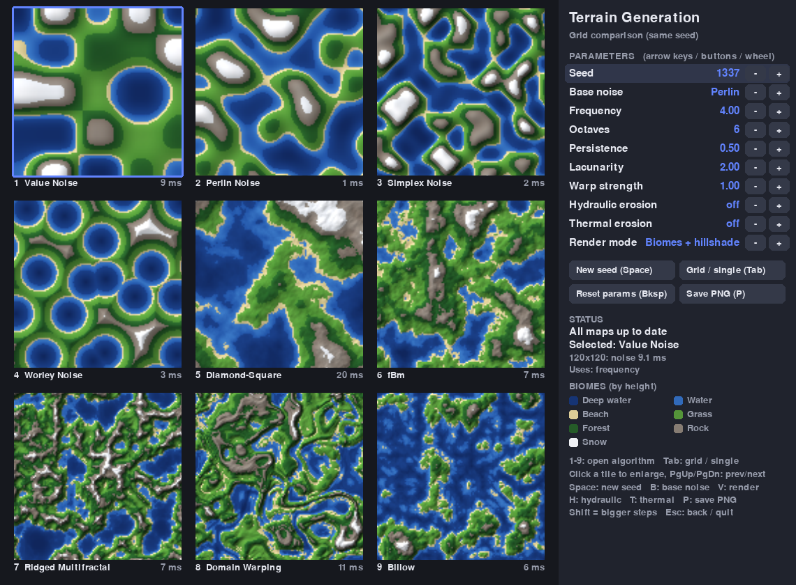
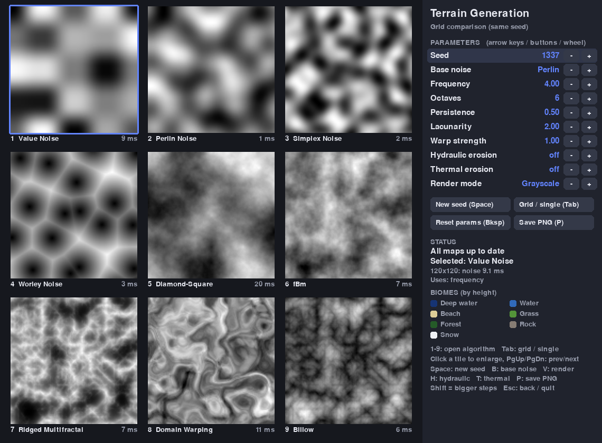
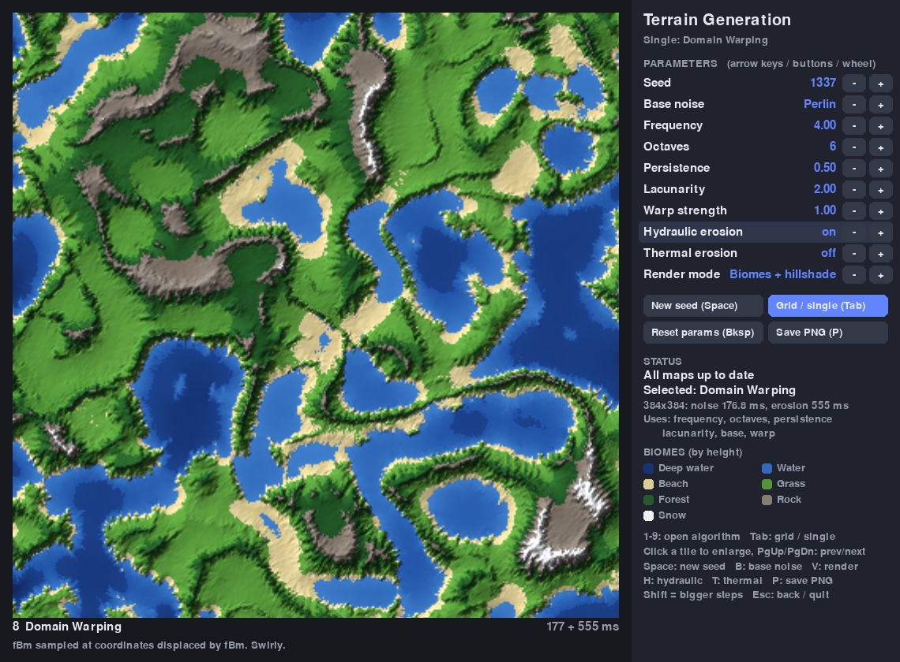

# Terrain Generation

An interactive side-by-side comparison of procedural terrain algorithms, built with
[Pygame](https://www.pygame.org/) and [NumPy](https://numpy.org/). Nine heightmap
generators render next to each other with the **same seed and parameters**, so you
can see exactly how Perlin differs from Simplex, what fBm octaves add, what ridged
noise and domain warping do, and how erosion changes a landscape.

Every algorithm is implemented from scratch in vectorised NumPy (no `noise` /
`opensimplex` packages), as pure functions completely separate from rendering.



## Features

- **Nine algorithms** in a 3×3 comparison grid, each with its generation time:

  | # | Algorithm | Family | Parameters used |
  |---|-----------|--------|-----------------|
  | 1 | Value Noise | Lattice noise | frequency |
  | 2 | Perlin Noise | Gradient noise | frequency |
  | 3 | Simplex Noise | Gradient noise | frequency |
  | 4 | Worley Noise | Cellular noise | frequency |
  | 5 | Diamond-Square | Subdivision fractal | frequency, persistence (= roughness) |
  | 6 | fBm | Fractal sum | frequency, octaves, persistence, lacunarity, base noise |
  | 7 | Ridged Multifractal | Fractal sum | same as fBm |
  | 8 | Domain Warping | Warped fractal | same as fBm + warp strength |
  | 9 | Billow | Fractal sum | same as fBm |

- **Single view**: open any algorithm full size (384×384 heightmap) with a short description.
- **Selectable base noise** (Perlin, Simplex, Value, Worley) for fBm, ridged, billow and domain warping.
- **Erosion post-processing**, toggleable: droplet-based **hydraulic erosion** and **thermal erosion**.
- **Four render modes**: grayscale heightmap, biome colours (deep water, water, beach, grass,
  forest, rock, snow), biomes with hillshading, grayscale with hillshading.
- **Stays responsive**: maps are generated incrementally in small chunks between frames
  (erosion yields after every batch of droplets), old images stay visible with an
  "updating" badge, and only tiles whose parameters actually changed are regenerated.
- **Resolution independent**: every map covers the same domain, so a grid tile and the
  single view of the same algorithm show the same terrain.
- **Save PNG** of the current view.



## Installation

Requires Python 3.10+.

```bash
git clone https://github.com/CommanderVibeCody/terrain-generation.git
cd terrain-generation
python -m venv .venv
source .venv/bin/activate        # Windows: .venv\Scripts\activate
pip install -r requirements.txt
```

## Running

```bash
python main.py
```

## Controls

| Input | Action |
|-------|--------|
| `1` – `9` | Open algorithm in single view |
| `Tab` | Toggle grid / single view |
| Click a tile | Open it in single view (click the map again to go back) |
| `PgUp` / `PgDn` (or `,` / `.`) | Previous / next algorithm |
| `↑` / `↓` | Select a parameter in the side panel |
| `←` / `→` (or `-` / `+`) | Decrease / increase the selected parameter |
| `Shift` + the above | Bigger steps |
| Mouse wheel over a parameter | Change it |
| `Space` / `R` | New random seed |
| `B` | Cycle base noise (Perlin → Simplex → Value → Worley) |
| `V` | Cycle render mode |
| `H` | Toggle hydraulic erosion |
| `T` | Toggle thermal erosion |
| `P` | Save a PNG of the window to `screenshots/` |
| `Backspace` | Reset all parameters (keeps the seed) |
| `Esc` | Back to the grid (single view) / quit (grid view) |

All parameters also have `-` / `+` buttons in the side panel:

| Parameter | Range | Meaning |
|-----------|-------|---------|
| Seed | 0 – 999 999 | Shared by all tiles for a fair comparison |
| Base noise | Perlin, Simplex, Value, Worley | Noise summed by the fractal algorithms |
| Frequency | 0.5 – 32 | Number of base lattice cells across the map (feature size) |
| Octaves | 1 – 10 | Number of noise layers in fBm / ridged / billow / warp |
| Persistence | 0.05 – 0.95 | Amplitude factor per octave (also the Diamond-Square roughness) |
| Lacunarity | 1.2 – 4.0 | Frequency factor per octave |
| Warp strength | 0 – 4 | How far domain warping displaces the coordinates |



## The algorithms in short

**Value noise** puts a random value on every integer lattice point and interpolates
between them with a smooth fade curve. Cheap and simple, but the lattice is clearly
visible (blobby squares).

**Perlin noise** (Ken Perlin, 1985/2002) puts a random *gradient* on every lattice
point instead. Each corner contributes the dot product of its gradient and the
offset to the sample point, blended with the quintic fade `6t⁵ − 15t⁴ + 10t³`.
The result is zero on the lattice and much more natural than value noise.

**Simplex noise** (Perlin, 2001) skews space onto a triangular lattice, so each
sample only needs three corners instead of four, with radial falloff kernels instead
of interpolation. Faster in higher dimensions and with fewer axis-aligned artefacts.

**Worley noise** (Steven Worley, 1996) scatters one random feature point per cell and
returns the distance to the nearest one (F1). That produces cells, like stones,
scales or craters. `worley_distances` also returns F2 for edge effects.

**Diamond-Square** builds a heightmap by recursive subdivision: the centre of each
square gets the average of its corners plus a random offset (diamond step), then the
edge midpoints get the average of their neighbours plus an offset (square step). The
offset shrinks by the *roughness* factor at every level.

**fBm (fractional Brownian motion)** sums several *octaves* of a base noise. Each
octave multiplies the frequency by the *lacunarity* and the amplitude by the
*persistence*: low octaves give continents and hills, high octaves add detail.

**Ridged multifractal** (F. Kenton Musgrave) uses `(1 − |noise|)²` per octave, which
turns the zero crossings of the noise into sharp ridges. Each octave is weighted by
the previous one, so detail piles up on the ridges while valleys stay smooth.

**Domain warping** (popularised by Inigo Quilez) samples fBm at displaced
coordinates: `h(p) = fbm(p + strength · (fbm(p + a), fbm(p + b)))`. The result looks
swirly, folded and organic.

**Billow** is fBm of `|noise|`: the absolute value creates creases at the zero
crossings and puffy, rounded hills in between (the inverse look of ridged noise).

### Erosion

**Hydraulic erosion** simulates thousands of rain droplets. Each droplet rolls
downhill with some inertia, picks up sediment while it is fast and below its carrying
capacity, and deposits sediment when it slows down, flows uphill or evaporates. This
carves gullies and valleys and fills basins. All droplets of a batch are simulated in
parallel with NumPy.

**Thermal erosion** lets material slide down wherever the slope is steeper than the
*talus angle*, moving part of the excess height to the lower neighbours. It softens
cliffs and spikes and builds scree slopes. Mass is conserved.

## Project structure

```
terrain-generation/
├── main.py                       # entry point
├── terrain/
│   ├── app.py                    # Pygame app: views, input, incremental generation
│   ├── ui.py                     # colours, fonts, buttons, legend
│   ├── rendering.py              # heightmap -> RGB (grayscale, biomes, hillshade)
│   ├── generator.py              # algorithm registry + noise -> erosion pipeline
│   ├── params.py                 # shared parameters (frozen dataclass, clamping)
│   ├── erosion.py                # hydraulic (droplets) and thermal erosion
│   └── noise/
│       ├── common.py             # seeded hash tables, fade, coordinate grid, normalise
│       ├── value.py
│       ├── perlin.py
│       ├── simplex.py
│       ├── worley.py
│       ├── diamond_square.py
│       └── fractal.py            # fBm, billow, ridged multifractal, domain warping
├── tests/                        # pytest suite (noise, erosion, headless app smoke tests)
├── tools/make_screenshot.py      # renders docs/*.png headlessly
└── docs/                         # screenshots
```

### Using the algorithms on their own

Each heightmap function takes `(width, height, seed, ...)` and returns a
`height × width` NumPy array normalised to `[0, 1]`. The lower-level samplers
(`perlin2`, `simplex2`, `value2`, `worley2`, `fbm2`) evaluate the noise at arbitrary
coordinates.

```python
from terrain.noise import fbm, ridged_multifractal, domain_warp
from terrain.erosion import hydraulic_erosion, thermal_erosion
from terrain.rendering import render

height = fbm(256, 256, seed=42, frequency=4, octaves=6, base="simplex")
height = hydraulic_erosion(height, seed=42)
rgb = render(height, "Biomes + hillshade")   # (256, 256, 3) uint8 array
```

## Tests

```bash
pip install -r requirements-dev.txt
pytest
```

The suite checks output shape, the `[0, 1]` value range, determinism for a fixed seed
and different results for different seeds for every algorithm; that the samplers are
bounded and continuous; that erosion keeps shape and range, is deterministic, carves
slopes and (thermal) conserves mass; and it runs the Pygame app headlessly
(`SDL_VIDEODRIVER=dummy`): the main loop, both views for every algorithm, every
key, every panel button, mouse clicks and parameter changes during generation.

To regenerate the screenshots:

```bash
python tools/make_screenshot.py
```

## License

[MIT](LICENSE)
